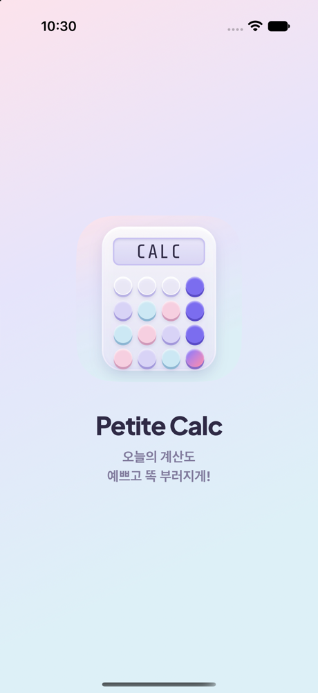
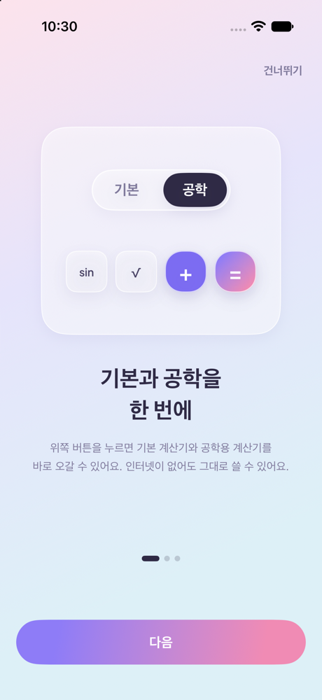
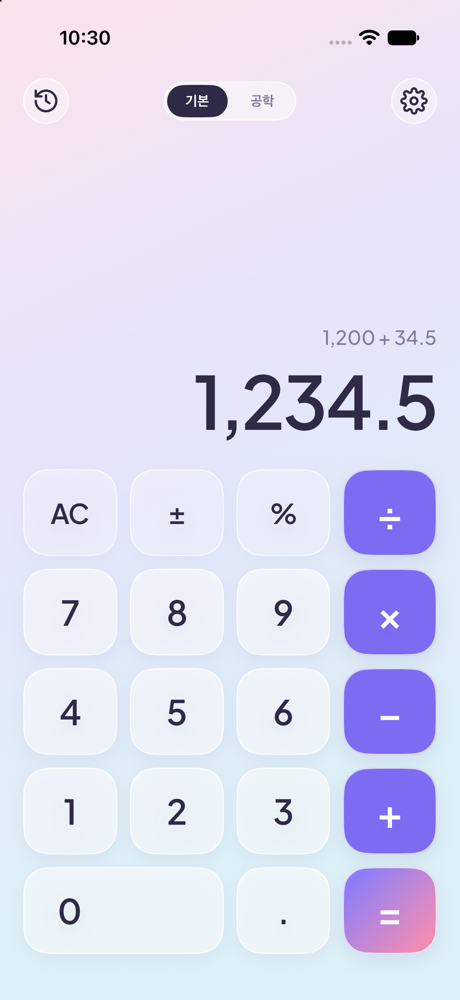
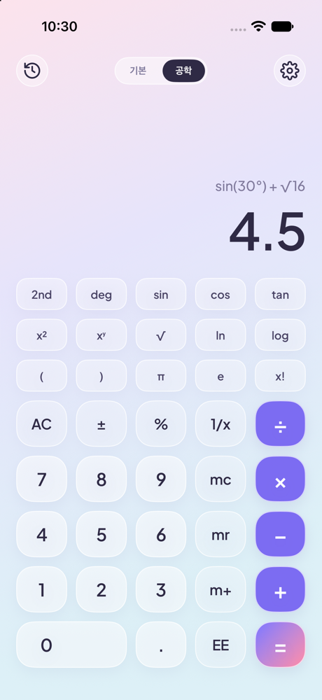
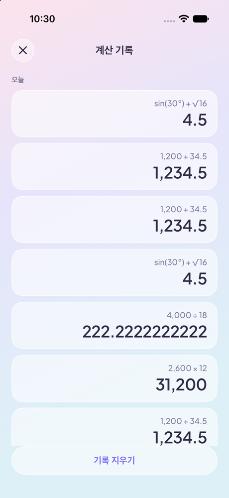
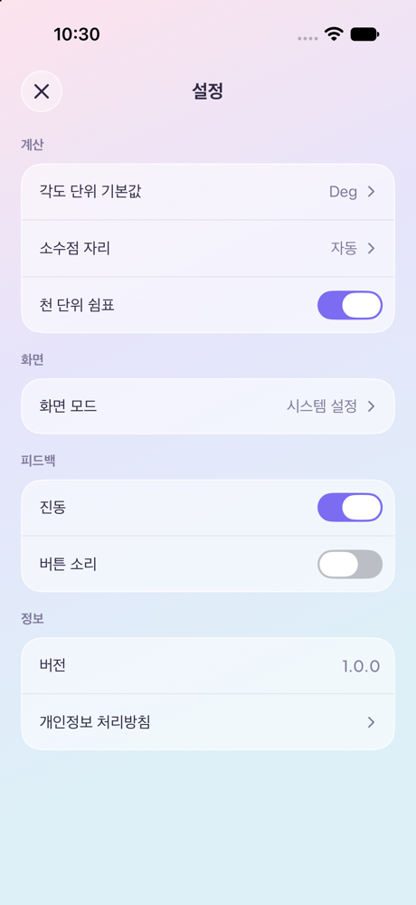
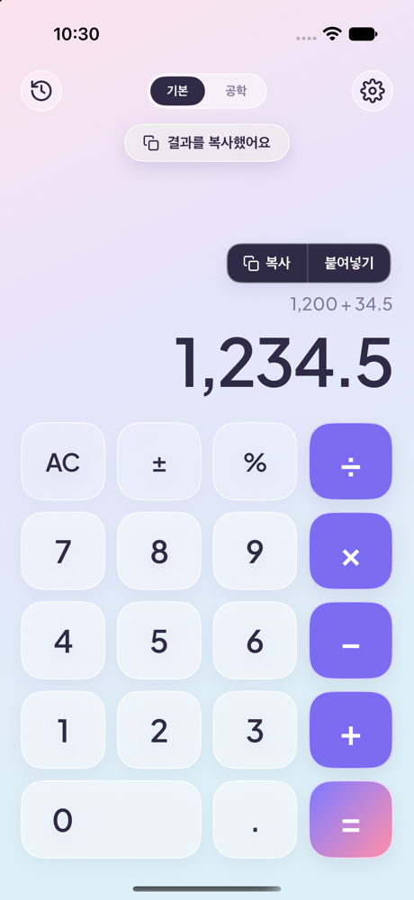
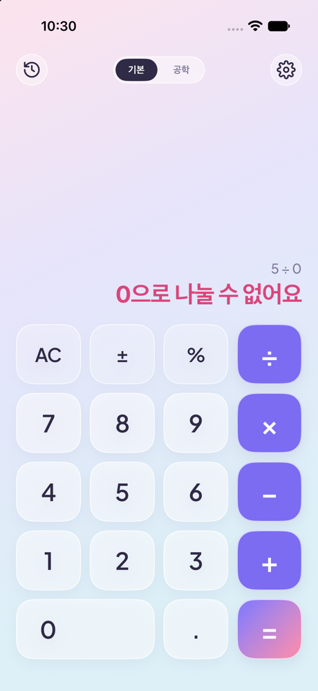
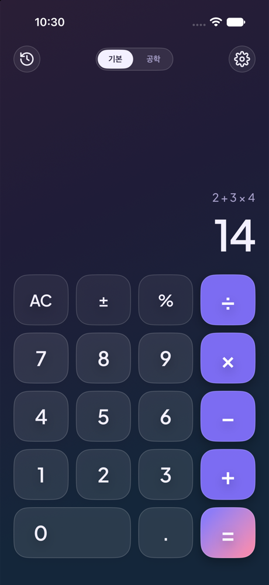
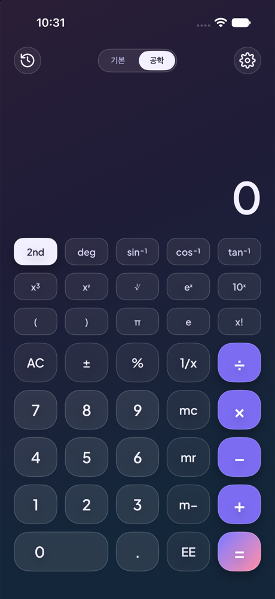

# Petite Calc (쁘띠 칼)

> 오늘의 계산도 예쁘고 똑 부러지게!

파스텔 글래스 톤의 아이폰 계산기 앱입니다. 피그마에서 디자인을 먼저 확정하고, SwiftUI로 만들어 iPhone 17 시뮬레이터와 실제 아이폰(iPhone 16 Pro)에서 확인했습니다.

## 기능

| 구분 | 내용 |
|---|---|
| 기본 계산기 | 사칙연산, AC, ±, %, 소수점. 곱셈·나눗셈을 먼저 계산 (2 + 3 × 4 = 14), `=` 반복 |
| 공학 계산기 | 괄호, sin·cos·tan(역함수), x²·x³·xʸ, √·∛, ln·eˣ, log·10ˣ, π, e, x!, 1/x, EE, 메모리(mc·mr·m+·m−), deg/rad |
| 정확한 계산 | `Decimal` 사용으로 0.1 + 0.2 = 0.3, 1 ÷ 3 × 3 = 1 |
| 계산 기록 | 최근 10개 저장(앱을 껐다 켜도 유지), 날짜별 묶음, 누르면 결과 불러오기 |
| 결과 복사 | 결과 숫자를 길게 누르면 복사·붙여넣기 메뉴, "결과를 복사했어요" 알림 |
| 오류 안내 | 0으로 나누기 등은 분홍 글씨로 안내 ("0으로 나눌 수 없어요") |
| 설정 | 각도 단위, 소수점 자리, 천 단위 쉼표, 화면 모드(시스템/라이트/다크), 진동, 버튼 소리 |
| 다크 모드 | 같은 파스텔 톤의 밤 버전 색상 |
| 시작 화면·안내 | 앱 아이콘 시작 화면, 처음 실행 때 안내 3장 |
| 오프라인 | 인터넷 없이 동작, 개인정보 수집 없음 |

## 확정한 디자인

| 항목 | 내용 |
|---|---|
| 톤앤매너 | 파스텔 글래스: 분홍·라벤더·하늘 그라데이션 위 반투명 유리 버튼 |
| 앱 이름 | Petite Calc |
| 앱 아이콘 | 실물 키캡 계산기 모양, LCD 문구 `CALC` |
| 런치 화면 | 큰 아이콘 + "Petite Calc" + "오늘의 계산도 / 예쁘고 똑 부러지게!" |
| 글꼴 | Plus Jakarta Sans (숫자·영문), 시스템 한글 글꼴 |

## 화면

| 순서 | 화면 | 디자인 | 앱 |
|---|---|---|---|
| 00 | 앱 아이콘 | 확정 | 완료 |
| 01 | 시작화면 (런치) | 확정 | 완료 |
| 02 | 온보딩 | 확정 | 완료 (안내 3장) |
| 03 | 기본 계산기 | 확정 | 완료 |
| 04 | 공학 계산기 | 확정 | 완료 |
| 05 | 계산 기록 | 확정 | 완료 |
| 06 | 설정 | 확정 | 완료 (+ 화면 모드) |
| 07 | 결과 복사 | 확정 | 완료 |
| 08 | 오류 | 확정 | 완료 |

## 실행 화면 (iPhone 17 시뮬레이터)

| 시작 화면 | 안내 | 기본 계산기 | 공학 계산기 | 계산 기록 |
|---|---|---|---|---|
|  |  |  |  |  |

| 설정 | 결과 복사 | 오류 | 다크 모드 (기본) | 다크 모드 (공학·2nd) |
|---|---|---|---|---|
|  |  |  |  |  |

## 실행 방법

1. Xcode에서 `PetiteCalc/PetiteCalc.xcodeproj`를 엽니다.
2. 위쪽 기기 선택칸에서 **iPhone 17** 시뮬레이터를 고르고 ▶ (⌘R).

**실제 아이폰에 설치**

1. Xcode → Settings → Apple Accounts에서 Apple ID 로그인
2. 프로젝트 → Signing & Capabilities → Team을 본인 Personal Team으로
3. 아이폰을 케이블로 연결 → "이 컴퓨터 신뢰"
4. 아이폰 설정 → 개인정보 보호 및 보안 → **개발자 모드** 켜기 (재시작)
5. 기기 선택칸에서 아이폰을 고르고 ▶
6. 처음 한 번: 아이폰 설정 → 일반 → VPN 및 기기 관리 → 개발자 앱 **신뢰**

무료 Apple ID로 설치한 앱은 7일 뒤 다시 설치해야 합니다. 최소 iOS 17.0.

## 겪은 문제와 해결 과정

| # | 문제 | 원인 | 해결 |
|---|---|---|---|
| 1 | Xcode를 켜면 템플릿 고르는 창 없이 "Untitled Project"가 바로 열림 | 이번 Xcode 버전은 처음 실행 시 빈 앱을 먼저 띄움 | 창을 닫고 File → New → Project(⇧⌘N)로 다시 만듦 |
| 2 | 프로젝트를 `~/Developer`에 잘못 저장 | 저장 위치 선택 실수 | Xcode에서 프로젝트를 닫은 뒤 폴더째 `계산기 어플 만들기/` 안으로 옮기고 다시 엶 |
| 3 | 2 + 3 × 4 가 20으로 나옴 | 첫 계산 엔진이 누른 순서대로만 계산 | 공학 모드에 괄호가 필요해 엔진을 새로 짬 (연산자 우선순위 + 괄호 처리, Shunting-yard 방식) → 14 |
| 4 | 0.1 + 0.2 가 0.30000000000000004 처럼 나올 위험 | `Double`의 이진 소수 오차 | 계산은 `Decimal`, 삼각·로그 함수 결과는 소수 12자리 반올림 (sin 30° = 0.5) |
| 5 | 공학 모드의 `1/x` 키를 누르면 숫자가 입력됨 | `case "0"..."9"` 문자열 범위 비교에서 "1/x"가 "0"~"9" 사이로 판정됨 | 숫자 판별을 "한 글자 + 숫자"로 바꿈 |
| 6 | `(2 + 3)²` 이 계산식에 `((2 + 3))²` 로 표시 | 괄호 묶음에 괄호를 한 번 더 씌움 | 이미 괄호로 감싼 식인지 검사 후 그대로 사용 |
| 7 | 실제 아이폰(iOS 26.6.2)에 설치가 안 됨 | Xcode 기본 최소 버전이 iOS 27.2 | 최소 버전을 iOS 17.0으로 낮춤 (사용 API가 모두 iOS 17부터) |
| 8 | 아이폰이 Xcode에서 "사용할 수 없음" | 개발자 모드가 꺼져 있음 | 아이폰 설정 → 개인정보 보호 및 보안 → 개발자 모드 켜고 재시작 |
| 9 | 설치는 됐는데 앱이 열리지 않음 | 무료 개발자 인증서를 아이폰이 아직 신뢰하지 않음 | 설정 → 일반 → VPN 및 기기 관리 → 개발자 앱 신뢰 |
| 10 | 빌드 중 "codesign이 키체인 접근" 비밀번호 요청 | 서명용 인증서가 맥 키체인에 있음 | 맥 로그인 비밀번호 입력 후 "항상 허용" |
| 11 | 홈 화면 앱 아이콘이 빈 칸 | AppIcon 이미지를 넣지 않았음 | 피그마 아이콘을 1024px로 렌더링해 추가. iOS가 모서리를 직접 둥글리므로 바깥 둥근 모서리는 빼고 넣음 |
| 12 | 앱을 켤 때 흰 화면이 번쩍임 | 시스템 시작 화면 기본색이 흰색 | `Info.plist`의 `UILaunchScreen` 배경색을 파스텔색(다크 모드는 남색)으로 지정 |
| 13 | 다크 모드에서 아이콘이 안 보임 | 피그마 SVG 아이콘 색이 진한 남색으로 고정 | 아이콘을 template 이미지로 바꾸고 글자색을 따라가게 함 |

## 개발 기록 (GitHub PR)

| PR | 내용 |
|---|---|
| #1 | 디자인 9개 화면 확정, README |
| #2 | Xcode 프로젝트 생성 |
| #3 | 기본 계산기 화면 SwiftUI 구현 |
| #4 | 기본 계산 기능 |
| #5 | 공학 모드·계산 기록·설정·다크 모드 |
| #6 | 최소 iOS 17.0, 서명 팀 지정 (실기기 설치) |
| #7 | 앱 아이콘 |
| #8 | 시작 화면·안내·결과 복사, README 정리 |
| #9 | 실행 화면 스크린샷, 겪은 문제와 해결 과정 |

## 코드 구조

| 파일 | 내용 |
|---|---|
| `Calculator.swift` | 계산 엔진 (계산 순서, 괄호, 공학 함수, 숫자 표시, 복사·붙여넣기) |
| `ContentView.swift` | 메인 화면 (기본/공학 키패드, 시작 화면·안내·복사 메뉴 띄우기) |
| `CalculatorComponents.swift` | 키, 결과 표시, 모드 토글, 아이콘 버튼 등 공용 부품 |
| `HistoryView.swift` | 05 계산 기록 |
| `SettingsView.swift` | 06 설정, 개인정보 처리방침 |
| `IntroViews.swift` | 01 시작 화면, 02 안내, 07 복사 메뉴·알림 |
| `Stores.swift` | 설정·기록 저장 (UserDefaults) |
| `Theme.swift` | 색(라이트·다크), 크기, 글꼴 |

## 디자인 파일

| 파일 | 내용 |
|---|---|
| `계산기 톤앤매너.html` | 확정 톤앤매너 가이드 (색, 버튼 5종, 글꼴, 크기, 원칙) |
| `계산기 톤앤매너 시안.html` | 처음 비교한 시안 4종 (미드나잇, 에어리 스카이, 레트로 LCD, 파스텔 글래스) |
| `아이콘 홈화면 미리보기.html` | 아이콘 LCD 문구 후보를 아이폰 홈 화면 크기로 비교 |

## 피그마

[Calculator App - Pastel Glass](https://www.figma.com/design/NIIL5PZgDcZ40k1fcnj4AX)

- **메인 페이지:** 확정본만, 앱 순서대로 가로로 이어 붙입니다. 00 앱 아이콘 → 01 시작화면 → 02 온보딩 → … → 08 오류.
- **02 후보 (임시):** 화면 종류별로 한 줄씩, 버전은 오른쪽으로 v1, v2…
- **01 Foundations:** 색·크기 변수 25개, 글자 스타일 7개, 유리 효과 2개
